# UI/UX-Audit & Optimierungskonzept: Einstiegsfreundlichkeit, Informationsarchitektur & Cognitive Load Reduktion

**Datum:** 16.10.2026  
**Basis:** Analyse von `v1.5.0` anhand von 5 Live-Screenshots sowie Code-Review der Präsentationsschicht (`lib/src/features/` & `lib/src/ui/`).  
**Zielsetzung:** Senkung der Einstiegshürde für neue Nutzer („Time-to-First-Message“), Abbau visueller Überfrachtung (Cognitive Overload) und Strukturierung aller Maßnahmen in **OpenSpec-fertige Capability-Spezifikationen**.

---

## 1. Executive Summary: Warum finden neue Nutzer das aktuelle UI zu kompliziert?

Kafkalyzer verfügt technisch über enorm mächtige Features (High-Speed Rust-Consumer, Smart Virtual JSON Tree, Feld-Projektionen, Multi-Step-Skripte, Fast-Trace-Hashing). Für **neue oder gelegentliche Nutzer** entsteht jedoch eine hohe Einstiegshürde durch fünf zentrale UX-Reibungspunkte:

1. **Passiver Kaltstart & „Tote Klicks“ (Dead-End Onboarding):**
   - Beim App-Start (Screenshot 1) sind **85 % des Bildschirms leer**.
   - Ein einfacher Klick auf ein Topic öffnet zwar einen Tab, zeigt aber **keine Nachrichten** (`"No messages to display"`), sondern klappt stattdessen ein riesiges, einschüchterndes Formular (`Suchkonfiguration` mit 12+ technischen Parametern) auf. Neue Nutzer wissen nicht, dass sie entweder **doppelt auf das Topic klicken** oder oben rechts auf den weit entfernten grünen `► Stream`-Button drücken müssen, um überhaupt Daten zu sehen.
2. **Drei konkurrierende Suchkonzepte auf einem Screen (Mental-Model-Kollision):**
   - In Screenshot 2 & 4 sieht der Nutzer gleichzeitig:
     1. **Broker-Scan-Filter** oben (`Suchkonfiguration` $\rightarrow$ `Field (Opt.)` & `Values (comma sep.)`), der erst bei erneutem Klick auf `Stream` wirkt.
     2. **In-Memory-Ergebnisfilter** in der Mitte (`Suchergebnisse...`), der sofort live die geladenen 200 Nachrichten filtert.
     3. **Payload-Inspektor-Suche** rechts (`🔍`), die innerhalb einer einzelnen JSON-Message sucht.
   - Neue Nutzer tippen in `Values (comma sep.)`, drücken Enter oder warten – und wundern sich, warum sich die Tabelle unten nicht ändert.
3. **Experten-Parameter auf Ebene 1 statt Progressive Disclosure:**
   - Optionen wie `Fast Trace (Hash Key)`, `RF: 3`, `delete`, `Startbedingung: Neueste` vs. `Stoppbedingung: Ende` (was für Einsteiger widersprüchlich klingt: *„Starte bei den Neuesten und stoppe am Ende“*) werden gleichrangig neben der einfachen Textsuche präsentiert.
4. **Visuelles Rauschen in der Topic-Sidebar (Screenshot 2 & 4):**
   - Jede einzelne Topic-Karte in der linken Liste wiederholt 5–6 technische Badges (`12 Partitions`, `RF: 3`, `delete`, `90.0 days`, `Avro`, `[👁 Schema]`). Dadurch passen auf einen großen Monitor vertikal nur **3 bis 4 Topics** gleichzeitig, und lange Topic-Namen mit identischen Präfixen (`kaenup.pmxcor.temp...`) brechen mehrzeilig um.
5. **Bruchstücke in Layout, Wording & Lokalisierung (Screenshots 2–5):**
   - **Sprach-Mix (Denglisch):** Mitten in der deutschen Oberfläche stehen hartcodierte englische Begriffe (`"Field (Opt.)"`, `"Values (comma sep.)"`, `"Contains / Regex / Exact"`, `"Scope: Key / Value / Both"`, `"Scan Progress"`, `"Configuration"`, `"Target Cluster"`).
   - **Entkoppelte Primary Action:** Der `► Stream`-Button klebt ganz oben rechts im Header *oberhalb* des Suchformulars statt am Ende des Suchformulars.
   - **Skript-Ansicht ohne Kontext (Screenshot 5):** Textfelder dehnen sich über 1.400 px Breite aus, es fehlt jede Erklärung, was ein Skript tut (welche Topics/Steps durchlaufen werden), und das Mülleimer-Icon (`🗑️`) löscht Skripte sofort ohne Sicherheitsabfrage.

---

## 2. Detaillierte Schwachstellen-Analyse nach Funktionsbereichen

```mermaid
flowchart TD
    subgraph Ist["Aktueller Einstiegs-Workflow (Hohe Reibung)"]
        A1["1. App Start: 85% leerer Screen"] --> A2["2. Klick auf Cluster (PROD)"]
        A2 --> A3["3. Immer noch leerer Screen ('Select a topic...')"]
        A3 --> A4["4. Einfachklick auf Topic"]
        A4 --> A5["5. Tab öffnet sich LEER + 12-Felder Suchkonfiguration erschlägt Nutzer"]
        A5 --> A6["6. Nutzer sucht Start-Button -> findet 'Stream' ganz oben rechts"]
    end

    subgraph Soll["Ziel-Workflow (Zero-Friction Onboarding)"]
        B1["1. App Start: Welcome-Dashboard mit Quick-Connect & letzten Topics"] --> B2["2. Klick auf Topic lädt sofort 'Quick Peek' (letzte 50–200 Nachrichten)"]
        B2 --> B3["3. Kompakter 1-Zeilen Suchbalken mit Presets ('Letzte 200', 'Live-Tail', 'Zeitraum')"]
        B3 --> B4["4. Erweiterte Kafka-Filter nur bei Bedarf per '+ Filter / Offset' aufklappbar"]
    end
```



---

## 3. Konkrete Verbesserungsvorschläge (OpenSpec-Ready)

Die folgenden **7 Maßnahmenpakete (Capabilities / Changes)** sind so geschnitten, dass jedes Paket direkt als eigenständiger OpenSpec-Change (`/opsx-propose`) umgesetzt werden kann.

---

### Maßnahme 1: Guided Onboarding, Auto-Preview & Empty States (`explorer-onboarding-and-auto-preview`)

#### 1.1 Problem im Ist-Zustand
- **Screenshot 1 (`ExplorerView`):** Wenn kein Cluster gewählt ist, zeigt `_buildNoClusterSelected` ([`explorer_view.dart:551`](file:///home/kaufmannr/git/greenhopper/kafkalyzer/lib/src/features/explorer/presentation/explorer_view.dart#L551)) nur ein blasses Icon. Die Cluster-Liste links (`DEV`, `TEST`, `PROD`) wirkt wie statischer Text ohne Verbindungsstatus oder Aktion zum Anlegen eines neuen Clusters.
- **Nach Cluster-Wahl:** `_buildNoTopicSelected` ([`explorer_view.dart:573`](file:///home/kaufmannr/git/greenhopper/kafkalyzer/lib/src/features/explorer/presentation/explorer_view.dart#L573)) zeigt den hartcodierten englischen Text `"Select a topic from the sidebar to start"`.
- **Nach Topic-Klick:** Ein Einfachklick (`onTap` in [`explorer_view.dart:489`](file:///home/kaufmannr/git/greenhopper/kafkalyzer/lib/src/features/explorer/presentation/explorer_view.dart#L489)) ruft `setActiveTopic` auf, startet aber keinen Ladevorgang. Der Nutzer landet vor `"No messages to display"` ([`messages_view.dart:629`](file:///home/kaufmannr/git/greenhopper/kafkalyzer/lib/src/ui/messages/messages_view.dart#L629)).

#### 1.2 Konkrete UX-Lösung
1. **Interaktives Empty-State-Dashboard im Hauptbereich:**
   - **Kein Cluster verbunden:** Zeige im Hauptbereich klickbare **Cluster-Karten** (mit Name, Broker-Host, Auth-Badge wie `SASL/SSL` und einem `Verbinden`-Button) sowie einen `+ Cluster hinzufügen`-Button (der direkt zu den Einstellungen navigiert) und eine Liste **„Zuletzt untersuchte Topics“** (Recent Topics).
   - **Cluster verbunden, kein Topic offen:** Zeige eine **Cluster-Übersicht** (Anzahl Topics, Schema Registry Status, Schnellzugriff auf die 5 zuletzt geöffneten Topics dieses Clusters).
2. **Informativer Empty-State im Topic-Tab (`MessagesView`):**
   - Wenn ein Topic geöffnet wurde, aber noch keine Nachrichten geladen sind, ersetze den nackten Text `"No messages to display"` durch eine klare Call-to-Action-Card:
     - Titel: *„Noch keine Nachrichten geladen“*
     - Primärer Button: **`[ ► Letzte 200 Nachrichten laden ]`** (führt sofort `startStreaming()` mit den aktuellen Einstellungen aus)
     - Sekundärer Hinweis: *„Tipp: Ein Doppelklick auf ein Topic in der Seitenleiste lädt Nachrichten sofort automatisch.“*

```
┌────────────────────────────────────────────────────────────────────────────┐
│                         📬 Noch keine Nachrichten geladen                  │
│                                                                            │
│       Lade die neuesten Nachrichten aus diesem Topic oder passe oben       │
│                    vorab deine Such- und Zeitfilter an.                    │
│                                                                            │
│                  [ ► Letzte 200 Nachrichten jetzt abrufen ]                │
│                                                                            │
│         💡 Tipp: Doppelklick auf ein Topic in der Liste startet sofort.    │
└────────────────────────────────────────────────────────────────────────────┘
```

#### 1.3 Betroffene Dateien
- [`lib/src/features/explorer/presentation/explorer_view.dart`](file:///home/kaufmannr/git/greenhopper/kafkalyzer/lib/src/features/explorer/presentation/explorer_view.dart)
- [`lib/src/ui/messages/messages_view.dart`](file:///home/kaufmannr/git/greenhopper/kafkalyzer/lib/src/ui/messages/messages_view.dart)
- [`lib/ src/features/topic/topic_detail_view.dart`](file:///home/kaufmannr/git/greenhopper/kafkalyzer/lib/src/features/topic/topic_detail_view.dart)

#### 1.4 OpenSpec-Spezifikations-Vorlage (`specs/explorer-onboarding/spec.md`)

```markdown
### Requirement: Interactive Cluster Selection Empty State
When no cluster is actively selected in the Explorer view, the main content area SHALL display an interactive onboarding view containing selectable cluster cards for all configured profiles and a direct action to configure a new cluster.

#### Scenario: Clicking a cluster card in the empty state connects immediately
- **WHEN** the Explorer view has no active cluster connection
- **AND** the user clicks on a cluster card in the center onboarding view
- **THEN** the system SHALL connect to that cluster and load its topics

### Requirement: Actionable Empty State in Topic Detail View
When a topic tab is open with zero loaded messages and no active scan running, the message area SHALL display an actionable empty state with a primary button to fetch messages immediately using the current configuration.

#### Scenario: Triggering scan from empty topic state
- **WHEN** a topic tab is open with no messages and `isStreaming` is false
- **AND** the user clicks the primary "Fetch latest messages" button in the empty state
- **THEN** the topic stream controller SHALL start consuming messages with the configured parameters
```

---

### Maßnahme 2: Vereinfachung der `Suchkonfiguration` durch Modus-Presets & Progressive Disclosure (`simplified-topic-search-bar`)

#### 2.1 Problem im Ist-Zustand (Screenshots 2 & 4)
- In [`TopicDetailView`](file:///home/kaufmannr/git/greenhopper/kafkalyzer/lib/src/features/topic/topic_detail_view.dart#L395) ist die `Suchkonfiguration` (`_buildSettings`) standardmäßig komplett aufgeklappt (`initiallyExpanded: true`) und zeigt gleichzeitig:
  - `Field (Opt.)`, `Values (comma sep.)`, `Type: Contains | Regex | Exact`, `Scope: Key | Value | Both`, `Limit: 200`, `Partition (Opt.)`, `Fast Trace (Hash Key)`, `Startbedingung` (4 Buttons + Box) und `Stoppbedingung` (4 Buttons + Box).
- **Widersprüchliches Wording:** Einsteiger verstehen die Kombination `Startbedingung: Neueste` + `Stoppbedingung: Ende` nicht. In Wahrheit gibt es **4 typische Nutzungsszenarien (Scan-Modi)**, die aktuell über zwei getrennte Boxen (`StartConditionConfiguration` und `EndConditionConfiguration`) zusammengesetzt werden müssen.
- **Entkoppelter Action-Button:** Der `► Stream`-Button sitzt im oberen Header, getrennt vom Suchformular. Zudem heißt er immer `"Stream"`, selbst wenn nur 200 historische Nachrichten geladen werden (`Stoppbedingung: Ende`).

#### 2.2 Konkrete UX-Lösung
1. **Kompakter 1-Zeilen-Schnellsuchbalken als Standard (Collapsed-by-Default für Expertenoptionen):**
   - Statt einer riesigen 200px hohen Parameterwand sieht der Nutzer standardmäßig **eine einzige aufgeräumte Steuerzeile**:
     - **Scan-Modus-Auswahl (4 verständliche Presets statt 2×4 Matrix):**
       1. `⚡ Letzte N Nachrichten` (*Default: liest die neuesten 200 Nachrichten bis High Watermark*)
       2. `📡 Live-Stream` (*Start: Neueste, Stopp: Laufend weiterstreamen*)
       3. `🕒 Zeitraum` (*Öffnet Von/Bis-Zeitstempel-Picker*)
       4. `🎯 Ab Offset / Anfang` (*Früheste oder spezifischer Start-/End-Offset*)
     - **Schnellfilter-Eingabe:** Ein kombiniertes Suchfeld `Nachrichten beim Laden filtern (Key oder Payload)...`
     - **Limit-Dropdown/Feld:** `Max: [ 200 ▼ ]` (50, 200, 500, 1000, Alle)
     - **Erweitert-Toggle (`⚙️ Erweitert`):** Klappt nur bei Bedarf Feld-Pfad (`Field`), `Regex/Exact`, `Partition`, `Fast Trace (Hash Key)` auf!
     - **Kontext-sensitiver Primary Button direkt in der Zeile:**
       - Heißt **`► Abrufen (200)`** bzw. **`► Suche starten`**, wenn ein endlicher Modus gewählt ist, und **`📡 Live-Stream starten`**, wenn der endlose Stream-Modus aktiv ist!
2. **Aktive Filter-Chips im eingeklappten Zustand:**
   - Sind erweiterte Filter gesetzt (z. B. `Partition: 3`, `Fast Trace`, `Regex`), werden diese als klickbare Filter-Badges direkt in der Kompaktzeile angezeigt.
3. **Visueller „Dirty State“-Indikator:**
   - Ändert der Nutzer einen Parameter im Suchformular, nachdem bereits Nachrichten geladen wurden, erhält der `► Abrufen`-Button einen pulsierenden/hervorgehobenen Hinweis (*„Filter geändert – Neu abrufen“*), damit klar ist, dass es sich um einen Server-Scan-Filter handelt.

```
┌──────────────────────────────────────────────────────────────────────────────────────────────────────────┐
│ Modus: [ ⚡ Letzte Nachrichten ▾ ]  Limit: [ 200 ▾ ]  [ 🔍 Filter beim Abruf (optional)... ]             │
│        [ ⚙️ Erweitert (Feld, Partition, Fast Trace) ▾ ]                    [ ► 200 Nachrichten abrufen ] │
└──────────────────────────────────────────────────────────────────────────────────────────────────────────┘
```

#### 2.3 Betroffene Dateien
- [`lib/src/features/topic/topic_detail_view.dart`](file:///home/kaufmannr/git/greenhopper/kafkalyzer/lib/src/features/topic/topic_detail_view.dart)
- [`lib/src/features/search/presentation/widgets/start_condition_configuration.dart`](file:///home/kaufmannr/git/greenhopper/kafkalyzer/lib/src/features/search/presentation/widgets/start_condition_configuration.dart)
- [`lib/src/features/search/presentation/widgets/end_condition_configuration.dart`](file:///home/kaufmannr/git/greenhopper/kafkalyzer/lib/src/features/search/presentation/widgets/end_condition_configuration.dart)

#### 2.4 OpenSpec-Spezifikations-Vorlage (`specs/topic-consumption/spec.md`)

```markdown
### Requirement: Preset-Based Scan Mode Selector
The topic search configuration SHALL provide intuitive scan mode presets ("Latest N Messages", "Live Tail Stream", "Time Range", "Custom Offset / Earliest") that automatically configure the underlying start and stop strategies without requiring users to manually combine separate start and stop matrices.

#### Scenario: Selecting "Latest N Messages" preset
- **WHEN** the user selects the "Latest N Messages" scan mode preset
- **THEN** the start strategy SHALL be set to `latest` and the stop strategy to `latest` (High Watermark)
- **AND** the primary action button label SHALL reflect a bounded fetch (e.g. "Fetch Messages") rather than an endless stream

#### Scenario: Progressive disclosure of advanced filter parameters
- **WHEN** a user opens a topic tab for the first time
- **THEN** advanced filter controls (`Field`, `FilterType`, `SearchScope`, `Partition`, `Fast Trace`) SHALL be collapsed behind an "Advanced Filter" toggle
- **AND** active non-default advanced parameters SHALL be summarized as chips when collapsed
```

---

### Maßnahme 3: Entschlackung der Topic-Sidebar & Präfix-Gruppierung (`compact-topic-sidebar`)

#### 3.1 Problem im Ist-Zustand (Screenshots 2 & 4)
- In [`TopicListItem`](file:///home/kaufmannr/git/greenhopper/kafkalyzer/lib/src/features/topic/presentation/widgets/topic_list_item.dart#L111) rendert jedes Topic in der 360px breiten Sidebar bis zu 6 Tags (`12 Partitions`, `RF: 3`, `delete`, `90.0 days`, `Avro`, `[Schema]`).
- **Folge:** Hohe vertikale Karten (~95–110 px pro Topic), sodass bei 466 Topics nur ~3,5 Topics gleichzeitig sichtbar sind. Informationen wie `RF: 3` oder `delete` sind bei der täglichen Suche nach einem Topic völlig irrelevant (sie stehen ohnehin im Header des Topic-Tabs, sobald man das Topic öffnet!).
- Außerdem sind die beiden Filter-Switches `"Internal Topics"` und `"Kafka Stream Topics"` ([`explorer_view.dart:394`](file:///home/kaufmannr/git/greenhopper/kafkalyzer/lib/src/features/explorer/presentation/explorer_view.dart#L394)) zwei große Zeilen über dem Suchfeld, die dauerhaft vertikalen Platz kosten.

#### 3.2 Konkrete UX-Lösung
1. **Schlankes 1–2-zeiliges `TopicListItem`:**
   - Zeige in der Sidebar-Liste pro Topic **nur**:
     - Den **Topic-Namen** (mit hervorgehobenem Suffix, z. B. `kaenup.pmxcor.temp.` gedimmt in Grau, **`incomingOutlookMessage`** fett hervorgehoben!).
     - Rechtsbündig maximal **2 kompakte Mikro-Badges**: Partitionen (`12P`) und ggf. `Avro`.
   - Alle Detail-Tags (`RF: 3`, `delete`, `90.0 days`, `Schema`-Button) werden aus der Sidebar-Karte entfernt (bzw. in einen Hover-Tooltip verlagert), da sie im geöffneten Topic-Header (`TopicDetailView`) bereits prominent angezeigt werden.
   - **Ergebnis:** Es passen **8–10 Topics statt 3,5 Topics** in die Sidebar!
2. **Filter-Switches als kompakte Filter-Chips oder Filter-Icon im Suchfeld:**
   - Ersetze die beiden klobigen `Switch`-Zeilen (`Internal Topics`, `Kafka Stream Topics`) durch zwei flache `FilterChip`s direkt unter dem Suchfeld (`[✓ Interne ausblenden] [✓ Stream-Topics ausblenden]`) oder ein Filter-Menü-Icon im Suchfeld.

```
VORHER (105px Höhe pro Karte):                 NACHHER (48px Höhe pro Karte):
┌────────────────────────────────────────┐     ┌────────────────────────────────────────┐
│ kaenup.pmxcor.temp.incoming            │     │ kaenup.pmxcor.temp.                    │
│ OutlookMessage                   ✓  ❐  │     │ incomingOutlookMessage     [12P] [Avro]│
│ [12 Partitions] [RF: 3] [delete]       │     └────────────────────────────────────────┘
│ [90.0 days] [Avro] [👁 Schema]         │
└────────────────────────────────────────┘
```

#### 3.3 Betroffene Dateien
- [`lib/src/features/topic/presentation/widgets/topic_list_item.dart`](file:///home/kaufmannr/git/greenhopper/kafkalyzer/lib/src/features/topic/presentation/widgets/topic_list_item.dart)
- [`lib/src/features/explorer/presentation/explorer_view.dart`](file:///home/kaufmannr/git/greenhopper/kafkalyzer/lib/src/features/explorer/presentation/explorer_view.dart)

#### 3.4 OpenSpec-Spezifikations-Vorlage (`specs/compact-topic-sidebar/spec.md`)

```markdown
### Requirement: High-Density Topic Sidebar Items
Each item in the Explorer topic list SHALL render in a compact layout displaying the topic name (with visual emphasis on the leaf segment after the last dot) and at most partition count (`<N>P`) and schema indicator (`Avro`) badges, omitting low-priority broker config tags (`RF`, `cleanup.policy`, `retention.ms`, inline Schema button) from the list card.

#### Scenario: Topic list item displays compact metadata
- **WHEN** a topic with 12 partitions, replication factor 3, delete policy, and an Avro schema is rendered in the sidebar
- **THEN** the list item SHALL display the topic name, `12P`, and `Avro` badge
- **AND** `RF: 3`, `delete`, `90.0 days`, and the inline `Schema` button SHALL only be displayed in the `TopicDetailView` header or tooltip
```

---

### Maßnahme 4: Klare Trennung von „Server-Scan-Filter“ vs. „In-Ergebnis-Suche“ & Vereinheitlichung der Tabellen-Sortierung (`unified-results-toolbar`)

#### 4.1 Problem im Ist-Zustand (Screenshot 4)
1. **Verwechslung der Suchfelder:** Das Suchfeld in der Ergebnis-Toolbar heißt `Suchergebnisse...` ([`message_search_bar.dart`](file:///home/kaufmannr/git/greenhopper/kafkalyzer/lib/src/ui/messages/widgets/message_search_bar.dart)). Neue Nutzer verstehen den Unterschied zwischen der oberen `Suchkonfiguration` (filtert während des Kafka-Konsums) und `Suchergebnisse...` (filtert lokal in den 200 geladenen Nachrichten) nicht.
2. **Doppelte Sortiersteuerung im Tabellenmodus:**
   - In [`MessagesView`](file:///home/kaufmannr/git/greenhopper/kafkalyzer/lib/src/ui/messages/messages_view.dart#L651) wird über der Tabelle `Zeitstempel ▼ ↓` (`message_sort_field_selector`) angezeigt.
   - Direkt darunter hat die Tabelle ([`MessagesTableView`](file:///home/kaufmannr/git/greenhopper/kafkalyzer/lib/src/ui/messages/views/messages_table_view.dart#L89)) **einen eigenen, unabhängigen Sortierzustand** (`_sortColumnIndex`, `_sortAscending`) pro Spaltenkopf! Sortiert man in der Tabelle nach `fromEmail`, zeigt der Dropdown darüber trotzdem weiter `Zeitstempel ▼` an.
3. **Unbeschriftete Ansichts-Icons:** Der `ViewModeSwitcher` zeigt nur drei kleine Icons (`Timeline`, `Table`, `Diff`) ohne Textlabel.

#### 4.2 Konkrete UX-Lösung
1. **Eindeutiges Wording & Ergebnis-Zähler in der Ergebnis-Toolbar:**
   - Links in der Toolbar steht klar der aktuelle Datenbestand: **`200 geladene Nachrichten`** (bzw. `14 von 200 Treffern`).
   - Das Suchfeld erhält den eindeutigen Platzhalter: **`In 200 geladenen Ergebnissen filtern...`** statt `Suchergebnisse...`.
2. **Ausblenden des redundanten Sortier-Dropdowns im Tabellenmodus:**
   - Wenn `_activeView == 'table'` aktiv ist, wird die Sortierung direkt über die Tabellen-Spaltenköpfe gesteuert (oder mit dem globalen Sortierzustand synchronisiert). Das doppelte `Zeitstempel ▼`-Dropdown wird nur in der `Timeline`- und `Diff`-Ansicht eingeblendet, wo es keine Spaltenköpfe gibt!
3. **Ansichts-Umschalter mit klaren Labels:**
   - Ergänze im `ViewModeSwitcher` kurze Textlabels neben den Icons: `[ 🕒 Timeline | ⊞ Tabelle | ⇄ Diff ]`.

#### 4.3 Betroffene Dateien
- [`lib/src/ui/messages/messages_view.dart`](file:///home/kaufmannr/git/greenhopper/kafkalyzer/lib/src/ui/messages/messages_view.dart)
- [`lib/src/ui/messages/widgets/view_mode_switcher.dart`](file:///home/kaufmannr/git/greenhopper/kafkalyzer/lib/src/ui/messages/widgets/view_mode_switcher.dart)
- [`lib/src/ui/messages/widgets/message_search_bar.dart`](file:///home/kaufmannr/git/greenhopper/kafkalyzer/lib/src/ui/messages/widgets/message_search_bar.dart)

#### 4.4 OpenSpec-Spezifikations-Vorlage (`specs/unified-results-toolbar/spec.md`)

```markdown
### Requirement: Context-Aware Sort Controls and Labeled View Switcher
The `MessagesView` toolbar SHALL display labeled segments for switching between Timeline, Table, and Diff views, and SHALL hide the redundant toolbar sort-field dropdown when the Table view is active (where sorting is controlled directly via table column headers).

#### Scenario: Sort dropdown hidden in Table view and visible in Timeline view
- **WHEN** `MessagesView` is in `table` mode
- **THEN** the toolbar sort-field dropdown (`message_sort_field_selector`) SHALL NOT be rendered
- **AND** switching to `timeline` mode SHALL display the sort-field dropdown
```

---

### Maßnahme 5: Schema-Integration als Side-Tab statt 90%-Riesen-Modal (`integrated-schema-inspector`)

#### 5.1 Problem im Ist-Zustand (Screenshot 3)
- Ein Klick auf `Schema` öffnet [`SchemaViewerDialog`](file:///home/kaufmannr/git/greenhopper/kafkalyzer/lib/src/features/schema/presentation/widgets/schema_viewer_dialog.dart#L126) als **90 % bildschirmfüllendes Modal**.
- Bei typischen Schemas mit 5–15 Feldern besteht das Modal zu **85 % aus leerer weißer Fläche** (siehe Screenshot 3).
- Gleichzeitig verdeckt das Modal die `Suchkonfiguration` und die Nachrichten-Tabelle komplett: Der Nutzer kann nicht ins Schema schauen, während er ein Suchfeld eintippt oder die Payload einer Nachricht vergleicht.

#### 5.2 Konkrete UX-Lösung
1. **Schema als 4. Reiter direkt im `MessageInspectorPanel` (oder als rechter Side-Drawer):**
   - Integriere das Topic-Schema als Tab **`Schema`** im rechten Inspector-Panel (`Payload | Key & Header | Rohes JSON | Schema`) bzw. als dritten Hauptmodus im Topic-Switcher (`Nachrichten | Topic-Analyse | Schema`).
2. **Interaktive Schema-Felder („Click-to-Filter“ & „Pin-as-Column“):**
   - Im Schema-Baum bekommt jedes Feld zwei Direkt-Aktionen:
     - `🔍 Nach diesem Feld filtern` (übernimmt den Feldnamen direkt in `Field (Opt.)` der Suchkonfiguration).
     - `📌 Als Tabellenspalte anheften` (fügt das Schema-Feld direkt als projizierte Spalte in `MessagesTableView` hinzu – auch bevor überhaupt die erste Nachricht angeklickt wurde!).

#### 5.3 Betroffene Dateien
- [`lib/src/features/schema/presentation/widgets/schema_viewer_dialog.dart`](file:///home/kaufmannr/git/greenhopper/kafkalyzer/lib/src/features/schema/presentation/widgets/schema_viewer_dialog.dart)
- [`lib/src/ui/messages/widgets/message_inspector_panel.dart`](file:///home/kaufmannr/git/greenhopper/kafkalyzer/lib/src/ui/messages/widgets/message_inspector_panel.dart)
- [`lib/src/features/topic/topic_detail_view.dart`](file:///home/kaufmannr/git/greenhopper/kafkalyzer/lib/src/features/topic/topic_detail_view.dart)

#### 5.4 OpenSpec-Spezifikations-Vorlage (`specs/integrated-schema-inspector/spec.md`)

```markdown
### Requirement: Non-Blocking Schema Inspection and Field Projection
Users SHALL be able to inspect a topic's Key and Value schemas without blocking the message stream view, and SHALL be able to pin any schema field directly as a projected table column.

#### Scenario: Pinning a field from the Schema viewer to the message table
- **WHEN** the user views a topic's Value schema
- **AND** clicks the "Pin as table column" action on a schema field row
- **THEN** the field path SHALL be added to the topic's projected table columns
```

---

### Maßnahme 6: Neugestaltung der Skript-Ansicht (`ScriptRunView` & `ScriptManagerView` - Screenshot 5) (`ergonomic-script-workspace`)

#### 6.1 Problem im Ist-Zustand (Screenshot 5)
1. **Ungeschütztes Löschen in der Sidebar:** In [`ScriptManagerView`](file:///home/kaufmannr/git/greenhopper/kafkalyzer/lib/src/features/scripting/presentation/script_manager_view.dart#L219) hat jedes Skript in der Liste dauerhaft ein Mülleimer-Icon (`Icons.delete`), das bei Klick **sofort und ohne Rückfrage** `controller.deleteScript(script.id)` ausführt!
2. **1.400 px breite Formularfelder ohne Kontext:** In [`ScriptRunView`](file:///home/kaufmannr/git/greenhopper/kafkalyzer/lib/src/features/scripting/presentation/widgets/script_run_view.dart#L130) strecken sich die Eingabefelder (`licensePlate (string)`, `from (timestamp)`) über die gesamte Fensterbreite.
3. **Fehlende Pipeline-Vorschau:** Ein neuer Nutzer wählt das Skript `Tracing` aus und sieht nur 3 Eingabefelder, weiß aber überhaupt nicht, **welche Topics** in **welchen Schritten** dieses Skript eigentlich abfragt!
4. **Fehlende Suchfunktion für Skripte:** Bei >15 Skripten in der linken Liste fehlt ein Such-/Filterfeld.

#### 6.2 Konkrete UX-Lösung
1. **Zwei-Spalten-Layout im Tab `Ausführen` (`ScriptRunView`):**
   - **Linke Spalte (max. 560 px Breite):** Sauber gefasste Card **„Skript-Parameter & Start“** mit Cluster-Auswahl, typisierten Eingabefeldern (mit schönen Badges `Text` / `Zeitstempel` statt `(string)` im Label) und einem prominenten **`[ ► Skript jetzt ausführen ]`**-Button direkt unter den Eingabefeldern.
   - **Rechte Spalte:** **Read-Only Pipeline-Vorschau („Ablauf-Schritte“)**, die visuell zeigt, welche Schritte das Skript ausführen wird (z. B. *„Schritt 1: Topic `tramon.kennzeichen` filtern nach `{{licensePlate}}` $\rightarrow$ extrahiert `transportId` $\rightarrow$ Schritt 2: Topic `kaenup.orders`“*). So versteht jeder neue Nutzer sofort, was das Skript tut!
2. **Lösch-Bestätigungsdialog & Kontextmenü in der Skript-Liste:**
   - Zeige `Duplizieren`, `Exportieren` und `Löschen` in einem `PopupMenuButton` (`⋮`) oder blende die Icons nur bei Hover ein – und sichere `Löschen` zwingend mit einem Bestätigungsdialog (`AlertDialog`) ab!

```
┌───────────────────────────────────────────────┬───────────────────────────────────────────────┐
│  SKRIPT AUSFÜHREN: Tracing                    │  PIPELINE-VORSCHAU (3 Schritte)               │
│                                               │                                               │
│  Ziel-Cluster:  [ ● PROD                  ▾ ] │  ① Step 1: Fahrzeug-Meilensteine              │
│                                               │    Topic: analytics.tramon.kennzeichen.v4     │
│  Kennzeichen (licensePlate):                  │    Filter: {{licensePlate}}                   │
│  [ z. B. W-12345X                           ] │    ↳ Extrahiert: transportId                  │
│                                               │         │                                     │
│  Zeitraum Von (from):                         │         ▼                                     │
│  [ 2026-10-16 12:00:00                  🕒 📅] │  ② Step 2: Transport-Aufträge                 │
│  [ -5m ] [ -15m ] [ -1h ] [ -6h ] [ -24h ]    │    Topic: kaenup.orders.v2                    │
│                                               │    Filter: {{transportId}}                    │
│  Zeitraum Bis (to):                           │                                               │
│  [ 2026-10-16 14:00:00                  🕒 📅] │                                               │
│                                               │                                               │
│  [ ► Skript starten (3 Schritte)            ] │                                               │
└───────────────────────────────────────────────┴───────────────────────────────────────────────┘
```

#### 6.3 Betroffene Dateien
- [`lib/src/features/scripting/presentation/script_manager_view.dart`](file:///home/kaufmannr/git/greenhopper/kafkalyzer/lib/src/features/scripting/presentation/script_manager_view.dart)
- [`lib/src/features/scripting/presentation/widgets/script_run_view.dart`](file:///home/kaufmannr/git/greenhopper/kafkalyzer/lib/src/features/scripting/presentation/widgets/script_run_view.dart)

#### 6.4 OpenSpec-Spezifikations-Vorlage (`specs/ergonomic-script-workspace/spec.md`)

```markdown
### Requirement: Confirmation Guard for Script Deletion
Deleting a script from the `ScriptManagerView` sidebar SHALL require explicit user confirmation via a dialog before removing the script from storage.

#### Scenario: User clicks delete on a script in the sidebar
- **WHEN** the user triggers the delete action on a script item
- **THEN** a confirmation dialog SHALL be displayed naming the script to be deleted
- **AND** the script SHALL only be deleted if the user confirms the dialog

### Requirement: Constrained Parameter Form and Pipeline Preview in ScriptRunView
The `ScriptRunView` form SHALL constrain parameter input widths to an ergonomic maximum (<= 600px), place the primary "Run Script" button directly below the inputs, and display a read-only overview of the script's configured execution steps and target topics alongside the form.

#### Scenario: Viewing a multi-step script in the Run tab
- **WHEN** a user selects a script in `ScriptManagerView` on the "Run" tab
- **THEN** the view SHALL display both the parameter input form and a read-only summary of each step's name, target topics, filter template, and extracted variables
```

---

### Maßnahme 7: Beseitigung des Sprach-Mixes (Vollständige DE/EN-Lokalisierung) & Discoverability im Inspector (`complete-ui-localization-and-discoverability`)

#### 7.1 Problem im Ist-Zustand (Alle Screenshots)
Überall in der App sind englische Strings hartcodiert, obwohl `AppLocalizations` (`app_de.arb` / `app_en.arb`) existiert:
- [`explorer_view.dart:398`](file:///home/kaufmannr/git/greenhopper/kafkalyzer/lib/src/features/explorer/presentation/explorer_view.dart#L398): `"Internal Topics"`, `"Kafka Stream Topics"`, `"Select a topic from the sidebar to start"`
- [`topic_detail_view.dart:339`](file:///home/kaufmannr/git/greenhopper/kafkalyzer/lib/src/features/topic/topic_detail_view.dart#L339): `"Scan Progress"`, `"Stream"`, `"Stop"`, `"Clear Messages"`, `"Field (Opt.)"`, `"Values (comma sep.)"`, `"Contains"`, `"Regex"`, `"Exact"`, `"Scope:"`, `"Key"`, `"Value"`, `"Both"`, `"Limit"`, `"Partition (Opt.)"`, `"Fast Trace (Hash Key)"`
- [`script_run_view.dart:141`](file:///home/kaufmannr/git/greenhopper/kafkalyzer/lib/src/features/scripting/presentation/widgets/script_run_view.dart#L141): `"Configuration"`, `"Target Cluster"`, `"Run"`, `"Execution Progress"`, `"New Run"`, `"No variables required."`
- [`messages_view.dart:629`](file:///home/kaufmannr/git/greenhopper/kafkalyzer/lib/src/ui/messages/messages_view.dart#L629): `"No messages to display"`
- **Versteckte Zeilen-Aktionen im JSON-Tree (Screenshot 2 & 4):** Im `SmartVirtualJsonTree` sind die beiden Icons rechts (`Copy` und `Pin as Column`) für jede Zeile permanent als winzige graue Symbole sichtbar (`Icons.copy`, `Icons.view_column_outlined`). Neue Nutzer erkennen das 3-Balken-Icon (`view_column_outlined`) nicht als *„Als Spalte anheften“*. Ein kleines Pin-Icon (`Icons.push_pin_outlined`) oder ein kurzer Hover-Button `+ Spalte` macht die Funktion sofort selbsterklärend.

#### 7.2 Betroffene Dateien
- [`lib/l10n/app_de.arb`](file:///home/kaufmannr/git/greenhopper/kafkalyzer/lib/l10n/app_de.arb) & [`lib/l10n/app_en.arb`](file:///home/kaufmannr/git/greenhopper/kafkalyzer/lib/l10n/app_en.arb)
- [`lib/src/features/explorer/presentation/explorer_view.dart`](file:///home/kaufmannr/git/greenhopper/kafkalyzer/lib/src/features/explorer/presentation/explorer_view.dart)
- [`lib/src/features/topic/topic_detail_view.dart`](file:///home/kaufmannr/git/greenhopper/kafkalyzer/lib/src/features/topic/topic_detail_view.dart)
- [`lib/src/features/scripting/presentation/widgets/script_run_view.dart`](file:///home/kaufmannr/git/greenhopper/kafkalyzer/lib/src/features/scripting/presentation/widgets/script_run_view.dart)
- [`lib/src/ui/smart_tree/smart_virtual_json_tree.dart`](file:///home/kaufmannr/git/greenhopper/kafkalyzer/lib/src/ui/smart_tree/smart_virtual_json_tree.dart)

#### 7.3 OpenSpec-Spezifikations-Vorlage (`specs/complete-ui-localization/spec.md`)

```markdown
### Requirement: Consistent Localization Across Explorer, Topic Search, and Scripting Views
All user-facing labels, buttons, empty states, and tooltips in `ExplorerView`, `TopicDetailView`, `MessagesView`, `SchemaViewerDialog`, and `ScriptRunView` SHALL be localized via `AppLocalizations` (`app_en.arb` and `app_de.arb`) without hardcoded English strings.

#### Scenario: German locale renders TopicDetailView and ScriptRunView completely in German
- **WHEN** the application locale is set to `de`
- **THEN** all search filter labels, scope selectors, scan progress indicators, empty states, and script configuration labels SHALL render in German
```

---

## 4. Priorisierte Umsetzungs-Roadmap (Empfohlene OpenSpec-Reihenfolge)

| Priorität | OpenSpec Change Name | Fokus & UX-Mehrwert | Aufwand |
| :--- | :--- | :--- | :--- |
| **Phase A (Prio 1)** | `simplified-topic-search-bar` | **Größter Hebel für Einsteiger:** Ersetzt die erschlagende 12-Felder-Matrix in `Suchkonfiguration` durch 4 verständliche Scan-Modi (*Letzte N*, *Live-Stream*, *Zeitraum*, *Offset*), klappt Experten-Optionen ein und platziert den `► Abrufen`-Button direkt am Formular. | Mittel |
| **Phase B (Prio 2)** | `explorer-onboarding-and-auto-preview` | **Beseitigt „tote Screens“:** Interaktive Cluster-Karten beim Start (Screenshot 1) und ein direkter `► Letzte 200 Nachrichten laden`-CTA im leeren Topic-Tab. | Klein–Mittel |
| **Phase C (Prio 3)** | `compact-topic-sidebar` | **2,5× mehr sichtbare Topics:** Schlanke Topic-Karten in der Sidebar ohne redundante Broker-Metadaten (`RF`, `delete`, `90d`) + kompakte Filter-Chips. | Klein |
| **Phase D (Prio 4)** | `unified-results-toolbar` | **Keine Verwirrung mehr beim Filtern & Sortieren:** Klare Trennung zwischen „Beim Abruf filtern“ vs. „In 200 geladenen Ergebnissen filtern“, Ausblenden des doppelten Sortier-Dropdowns in der Tabellenansicht und beschriftete View-Buttons (`Timeline`, `Tabelle`, `Diff`). | Klein |
| **Phase E (Prio 5)** | `ergonomic-script-workspace` | **Skripte sofort verstehen & sicher bedienen:** 2-Spalten-Layout mit Pipeline-Vorschau im `Ausführen`-Tab, begrenzte Eingabebreiten und Lösch-Bestätigungsdialog. | Mittel |
| **Phase F (Prio 6)** | `complete-ui-localization-and-discoverability` | **Politur & Konsistenz:** Beseitigung aller Denglisch-Brüche in DE/EN sowie klarere `+ Spalte`-Affordance im JSON-Tree. | Klein |
| **Phase G (Prio 7)** | `integrated-schema-inspector` | **Kein 90%-Riesen-Modal mehr:** Schema-Ansicht als Side-Tab im Inspector mit *Click-to-Filter* und *Pin-as-Column*. | Mittel |
